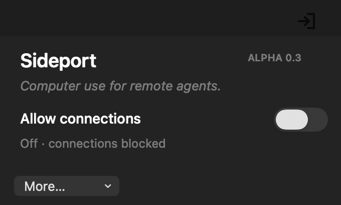
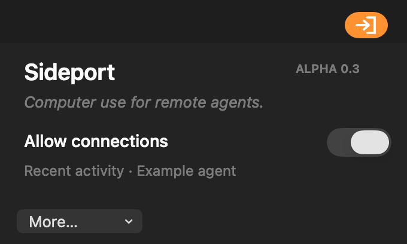
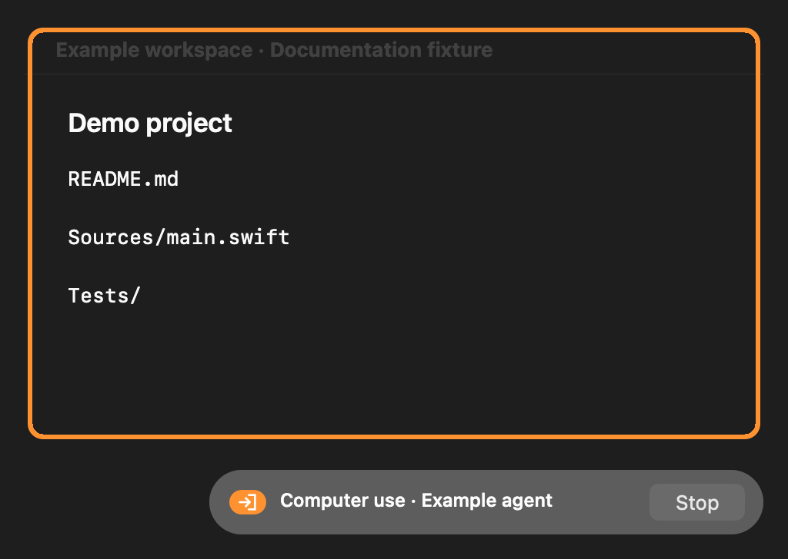
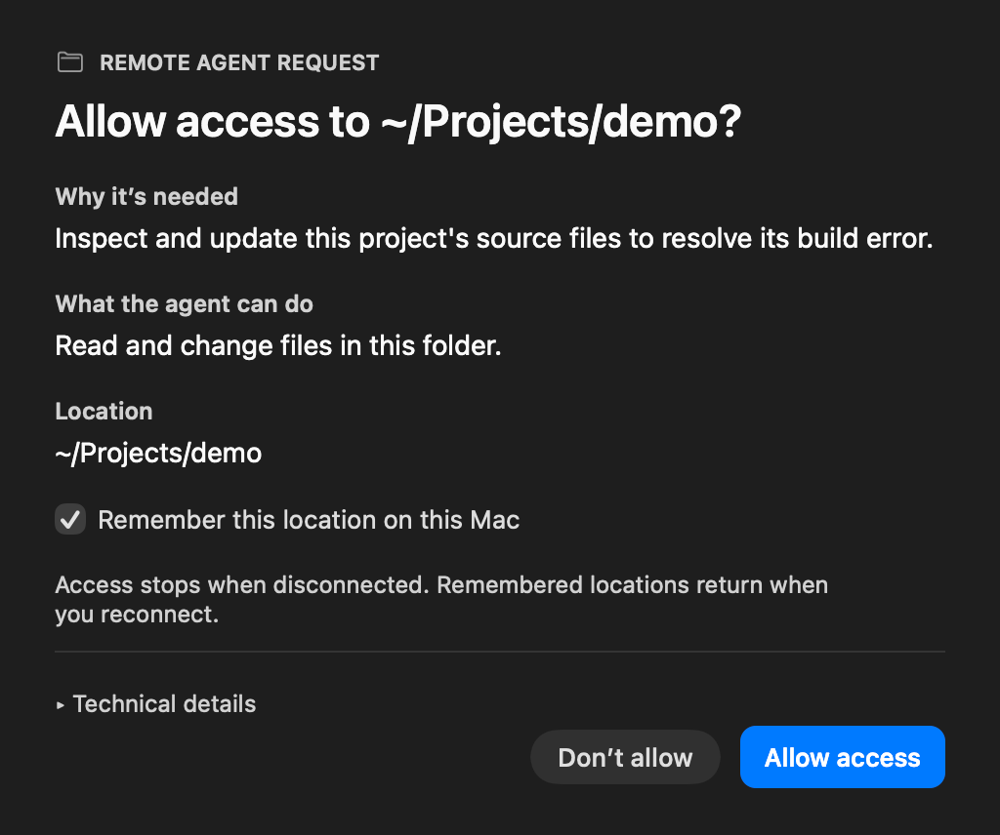

# Sideport

**Computer use for remote agents.**

Sideport is a macOS menu-bar app that lets a remote MCP agent work on your Mac while you allow connections. It combines computer use, scoped file and shell tools, local approvals, and MCP-server discovery in one native app.

Access starts off. You choose when the Mac becomes available, approve additional capabilities locally, and can stop access from the menu bar or the computer-control overlay.

## Project direction

Sideport provides the Mac's tools and local access controls; the connected client supplies the agent's planning and reasoning. The goal is a small, dependable utility that stays quiet while disconnected, supports ordinary desktop and development work, and acquires additional MCP tools only when a task needs them.

After one-time setup, using it should mean enabling access, making understandable scope decisions, and stopping when finished. Settings and remembered folders should survive updates. Maintained upstream components and a small native core should keep that workflow working without an ongoing integration project.

Sideport is not an agent hosting platform, a new package manager or a substitute for an isolated virtual machine. Tool extensibility must preserve local consent and protect the app's own policy and credentials. These are product goals; [current status](docs/status.md) describes the alpha's remaining gaps. The [project scope](docs/project-scope.md) defines the boundaries and acceptance criteria for further implementation.

<table>
<tr>
<td></td>
<td></td>
</tr>
<tr><td>Connections off</td><td>Agent connected</td></tr>
</table>

## What it can do

- **Computer use:** observe windows, capture images, enter text, click controls, and drag between freshly resolved elements. Computer control requires its own approval.
- **Files and shell:** read and write approved folders, run development commands, and request additional locations when needed. Shared toolchains and development caches are available to the shell.
- **Command review:** screen flagged commands with DCG and an optional decision model. Uncertain decisions still go to you.
- **GitHub access:** use the Mac’s existing GitHub CLI login through a credential proxy, with local approval for operations classified as destructive or unknown.
- **Additional MCP servers:** discover providers through MCPProxy, request exact-version npm servers, or forward existing agents-dev and Smithery connections after approval.

An orange menu-bar pill indicates a confirmed agent session. During desktop use, Sideport outlines the selected window and shows a client/Stop pill without taking keyboard focus. **Stop disconnects Sideport, including file and shell access.**



*The images show native Sideport UI rendered with synthetic documentation data, not live agent connections.*

## Access and approvals

File and shell tools run inside approved scopes. An agent can request another folder, but the decision appears on your Mac. You can remember that location for later connections and revoke it from **Remembered locations**.



Computer control is broader: it can operate apps beyond the file sandbox. Shell commands have network access, and shared development caches are writable. These are deliberate compatibility choices; Sideport is not a virtual machine or a proof that arbitrary agent code is safe. See the [security boundaries](docs/security.md).

## Current status

**Early alpha · Apple Silicon · macOS 15 or later.** The native 0.3.2 baseline has 21 regression groups, isolated integration checks, and controlled computer-use validation. It is ready for technical alpha testing, with the remaining gaps recorded in [status and limitations](docs/status.md).

The source is public. Developer ID signing and notarized public builds are pending. The current **Check for updates** flow updates runtime dependencies; app replacement through an in-app updater is still being developed. Initial tunnel provisioning is also manual.

The packaged remote connection currently uses OpenAI’s Secure MCP Tunnel. ChatGPT is an example client; other clients need a compatible connection path. Sideport’s broker supports July 2026 MCP discovery alongside older-client fallback.

## Build and try it

You need macOS, an Apple Silicon Mac, and Swift 6.2 or later with Apple’s developer tools.

```sh
git clone https://github.com/anschmieg/sideport.git
cd sideport
swift build --build-system native -c release
.build/release/Sideport --regression-tests
```

A source build can run regression checks and render the documentation UI. Running the full app also needs verified runtime dependencies and the one-time tunnel setup. The [development guide](docs/development.md) explains those inputs; the [user guide](docs/getting-started.md) explains everyday use with a configured installation.

## Repository map

| Path | Contents |
|---|---|
| [`Sources/Sideport/`](Sources/Sideport/) | Native app, broker, computer use, permissions, providers and runtime supervision |
| [`Resources/`](Resources/) | App icon, tool manifest and runtime configuration templates |
| [`scripts/`](scripts/) | Packaging, integration checks and screenshot generation |
| [`docs/`](docs/) | User and developer guides, architecture, screenshots and audit records |
| [`AGENTS.md`](AGENTS.md) | Repository instructions and validation boundaries for coding agents |
| [`.impeccable.md`](.impeccable.md) | Native macOS design context and interaction principles |
| [`.agents/skills/`](.agents/skills/) | Focused repository validation skill |
| [`Package.swift`](Package.swift) | Swift targets and dependency pins |

The earlier JavaScript broker is preserved on the [`legacy-node` branch](https://github.com/anschmieg/sideport/tree/legacy-node). It is not part of the native app’s main source tree. Node is acquired only when an npm provider or Smithery integration needs it.

## License

Sideport’s source is [MIT licensed](LICENSE). Third-party components retain their own licenses; packaging includes their notices.
