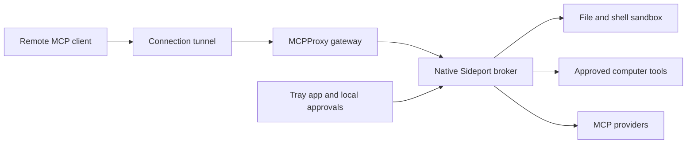

# Architecture

Sideport has a native Swift tray app and broker. PeekabooAutomationKit is compiled into the app. MCPProxy provides discovery, aggregation and the authenticated local gateway. The current remote transport is the official runtime-only OpenAI tunnel.

The tray app starts disconnected. Enabling connections provisions a fresh approval session and scoped gateway credential, then starts the gateway and tunnel. Disabling connections stops managed work and services and removes the session credential. Remembered folder identities persist separately; computer and provider approvals expire with the connection.

File, shell and local provider execution use nono profiles. A trusted custodian creates a distinct kernel audit session for each sandbox job and tracks it across detachment, completion, timeout and controller failure. Controller state and trusted helper code are excluded from agent write grants.

Computer tools run through the broker after a separate local approval. The wrapper retains recent observations and binds input to checked window and element identities. Drag endpoints use selectors; coordinates are not accepted by the drag contract. This path has broader desktop access than the file sandbox.

MCPProxy discovers additional providers. Dynamic npm servers need an exact version, package audit and local approval; installation scripts are disabled and the running provider has no network access. Existing agents-dev and Smithery connections can be forwarded with their configured credentials after local approval. Node is optional and acquired on demand.

Activity indicators use the maintained tunnel runtime's `/health/dispatcher` live-operation count, sampled every half-second while connected. Idle polling, cumulative counters and retained gateway sessions do not activate the pill. The health reader accepts only its protected IPv4-loopback endpoint, refuses redirects and caching, and rejects malformed or stale snapshots. Unknown health is shown explicitly rather than filled in from history.

The broker publishes a protected receipt for each executing tool and removes it on completion or failure. The tray checks the receipt's kernel process identity, so a dead or reused PID cannot leave an operating indicator. These receipts provide **Operating**; an in-flight tunnel operation provides **Connected**. This describes current request lifecycles, not a persistent conversation or the tunnel's cached local HTTP connection. Very short requests may complete between UI samples.

The default local display label is ChatGPT. Another configured client can set `work/client-label.json` with a `label` string under Sideport's Application Support directory. Labels are not authenticated remote identities, and simultaneous conversations sharing the transport cannot be counted separately.

Desktop actions publish a unique action ID and wait for the tray’s matching visibility acknowledgement before proceeding. The overlay clears after eight seconds of inactivity, on disconnect or when its broker exits. Its client pill uses the same configured label.

The shell's strict Mach-service allowlist includes the OpenDirectory Libinfo query endpoint for POSIX UID/name resolution. The separate directory-management API remains denied, alongside screen, Accessibility and Keychain services.

## Components

| Component | Upstream |
|---|---|
| Computer use | [Peekaboo](https://github.com/openclaw/Peekaboo) |
| Discovery and gateway | [MCPProxy](https://github.com/smart-mcp-proxy/mcpproxy-go) |
| Remote connection | [OpenAI tunnel-client](https://github.com/openai/tunnel-client) |
| Execution sandbox | [nono](https://github.com/nolabs-ai/nono) |
| Destructive-command screening | [DCG](https://github.com/Dicklesworthstone/destructive_command_guard) |

The application’s dependency pins and release metadata determine the actual versions. Standalone dependencies update through checksum and compatibility checks with rollback. The compiled computer-use library updates with a rebuilt app.
